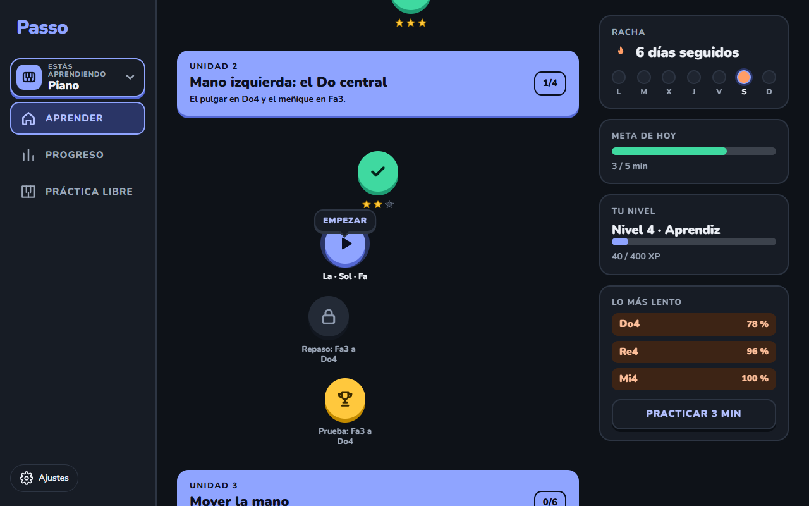
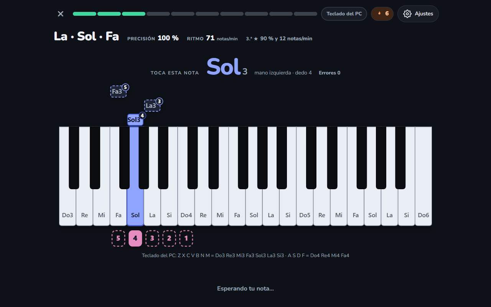
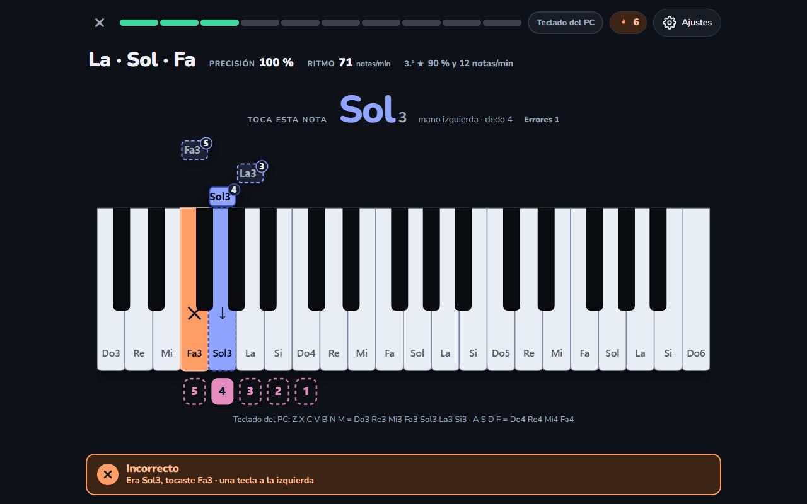
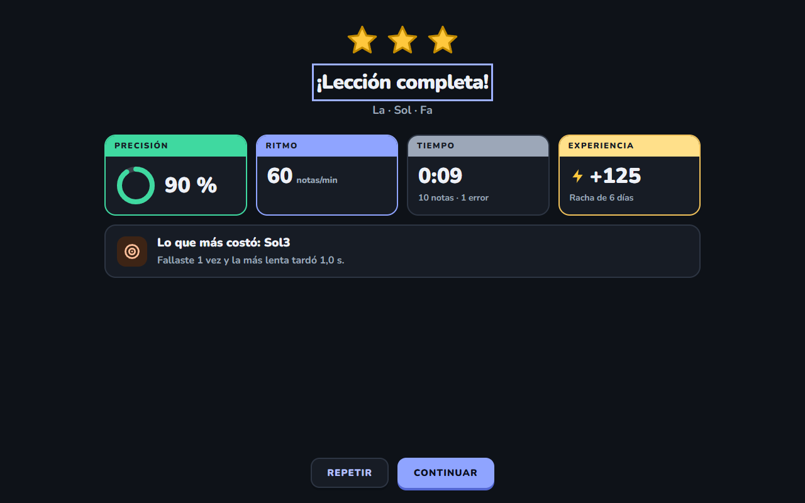
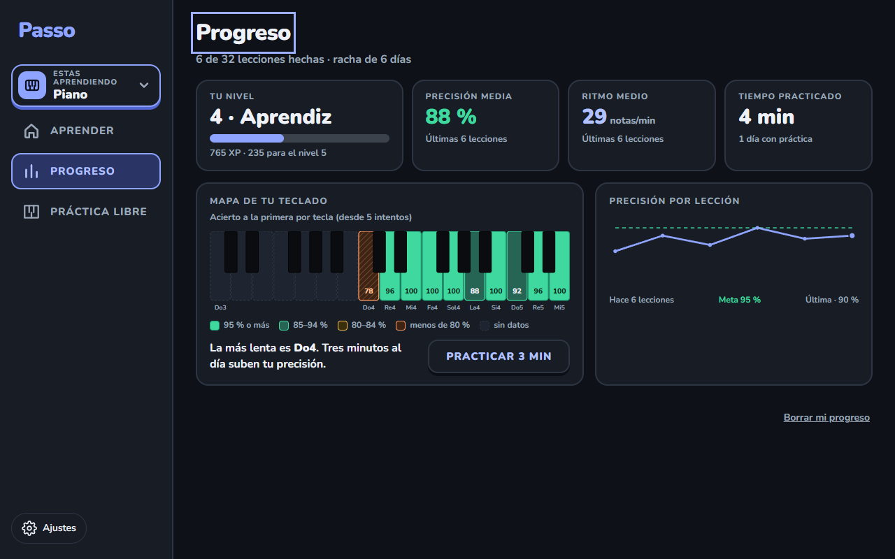
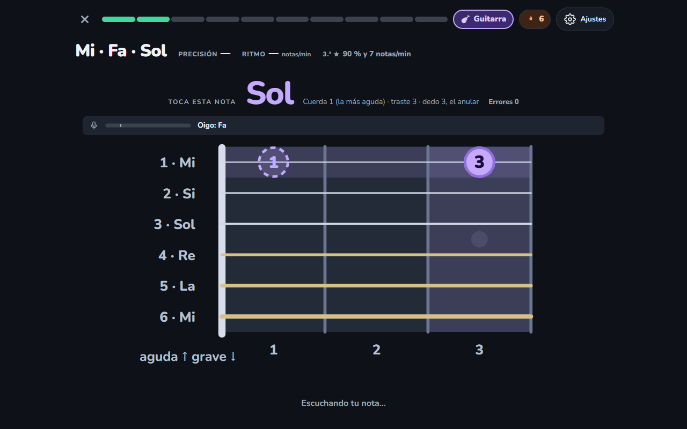
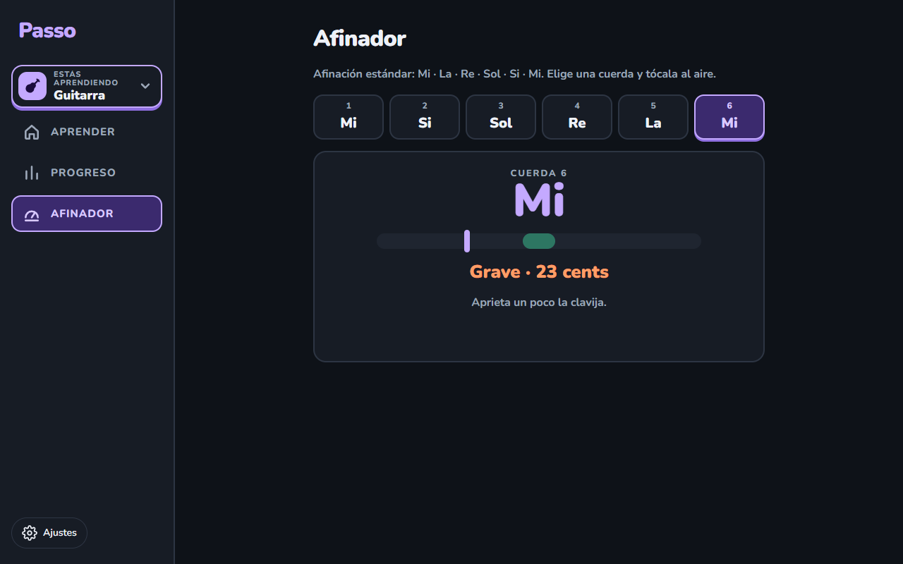

# 🎹 Passo — Learn piano and guitar with instant correction

🇬🇧 English · 🇪🇸 [Español](README.es.md)

> A web app to learn **piano and guitar with instant correction**: you play, Passo listens through the
> microphone and tells you right away what went well and what didn't. Personal project, October 2026.

`React 19` · `TypeScript` · `Vite` · `Clean Architecture` · `Web Audio` · `Web MIDI` · `Vitest` · `Playwright`

> **Problem:** Learners who practice with videos and courses get no immediate correction of what they play.
> **Solution:** Passo listens through the microphone and corrects each note instantly, in a game-like path for piano and guitar.
> **Stack:** React 19, TypeScript, Vite, Web Audio and Web MIDI, Clean Architecture, Vitest, Playwright.
> **Live demo:** None (a walkthrough is available on request).
> **My role:** Solo project, end to end: product scope, architecture, audio processing, UI, tests and documentation, with an AI assistant under a written method.

*Screenshots of the app itself, generated by a test with a simulated microphone.*

---

## The problem
People who learn an instrument from videos and courses end up playing what they already know, and
nobody corrects them in the moment. The apps that do correct usually require a USB-MIDI piano or send
the audio to a server, and most treat every mistake the same: they can't tell whether you hit the
wrong key or the microphone simply wasn't sure.

## The solution
Passo shows what to play, listens, corrects instantly and takes the student to practice exactly what
they struggle with most:

- **🎹 Instant correction.** Each note is judged as it sounds: correct, wrong (with «it was G, you
  played F, one key to the left») or a microphone doubt, which **does not count as a mistake**.
- **🎙️ With the instrument you already have.** The laptop microphone is the main input; it also works
  with a MIDI piano and the computer keyboard. Audio is analyzed in the browser: nothing is recorded
  or sent anywhere.
- **🎮 A game, not an exam.** A path of units and short lessons, stars, experience points, a daily
  streak and a daily goal.
- **🎸 Two instruments in one app.** Piano (6 units, 32 lessons) and guitar (3 units, 14 lessons,
  fretboard and tuner), each with its own path and progress.
- **🔁 Weak-spot review.** «Practice 3 min» builds a lesson on the spot with the notes you miss most,
  and the keyboard heat map shows which ones slip away.
- **📱 Fits in 320 px** with no horizontal scrolling, and meets AA contrast, verified by tests.

## Screenshots

| | |
|---|---|
|  |  |
| *Note, hand, finger, falling notes and live rhythm.* | *«It was G3, you played F3 · one key to the left».* |
|  |  |
| *Stars, accuracy and what was hardest.* | *Keyboard heat map and accuracy curve.* |
|  |  |
| *Fretboard with string, fret and finger.* | *Tuner: «Flat · 22 cents».* |

## Key technical decisions
- **Active listening, not just pitch detection.** Microphone input goes through its own pipeline:
  per-frame energy and onset → McLeod pitch detection (own implementation) → a note tracker with
  confirmation, octave and learned tuning → a note event with a confidence level. A doubtful note
  never counts as a mistake.
- **Clean Architecture enforced by tools.** Pure TypeScript domain (no DOM, clock or randomness of its
  own), use cases, ports (`NoteInput`, `Clock`, `ProgressStore`…) and interchangeable adapters.
  `dependency-cruiser` and ESLint reject any import that breaks the layers. That is why microphone,
  MIDI and the computer keyboard are the same interface, and why tests swap them for fakes.
- **For guitar, the note name is judged, not the octave:** guitar is written an octave above where it
  sounds and the microphone misreads low strings. The fretboard shows where to play it.
- **Progress is derived, not stored.** Which lessons are unlocked comes from the stars. Data lives in
  versioned `localStorage`: anything damaged or from a newer version never breaks the app and is
  never overwritten.
- **Private and serverless.** No accounts, no cloud, no ads. Runtime dependencies: only React and the
  self-hosted Nunito typeface.
- **Tests with synthetic audio.** A Karplus-Strong guitar and oscillator piano tones feed the simulated
  microphone, so end-to-end tests are deterministic and the README screenshots are regenerated with
  one command.
- **A phased method.** One phase at a time, with a plan, a review from three perspectives (music and
  pedagogy, UI and experience, architecture; AI agents), small commits, video evidence and a closing report.

## Repository numbers
1,375 unit, integration and UI tests · 58 end-to-end tests in Edge · AA contrast verified by tests.
Built in 19 days (October 13–31, 2026).

## Result
Phases 0 to 3 and guitar stage 1 are complete: microphone listening, settings, thirds and chords, a
game with a path, stars, streaks and progress, and guitar with fretboard and tuner. Every closed
phase leaves its report, its video and its screenshots.

**What is missing, plainly:** all test audio is synthetic. The thresholds for the tuner and the low
guitar strings come from simulations and still need to be confirmed with a real piano and guitar.
Pending: guitar arpeggios and chords, tablature, songs bar by bar, and the adaptive engine for
practice by sections.

## My role
A personal project built by me from start to finish: product and scope of each phase, architecture,
audio processing, UI, tests and documentation, working with an AI assistant under a written method
and conventions.

---

> 📖 **Source code is public:** [github.com/KevinHGitCode/Passo](https://github.com/KevinHGitCode/Passo)
> (view-only license: you may read it, not reuse it). This repository is the case study. I can also
> walk you through the code and the running app in a technical interview.

**Contact:** [GitHub](https://github.com/KevinHGitCode) · [LinkedIn](https://www.linkedin.com/in/kevin-diaz-garcia-846999240/) · [Instagram](https://www.instagram.com/kevin.hdiaz/) · kevinhafiddiazgarcia@gmail.com

© 2026 Kevin Díaz. All rights reserved. Text and screenshots may not be reused without permission.
